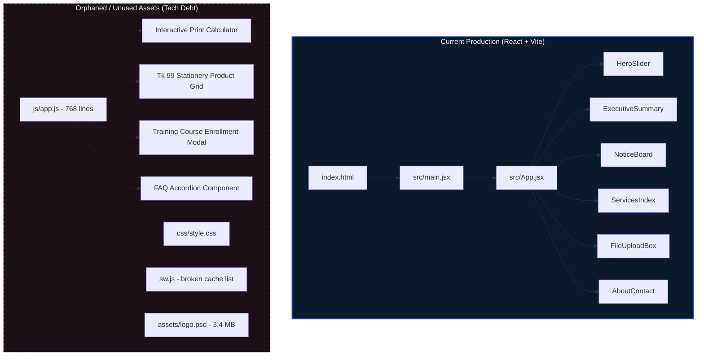
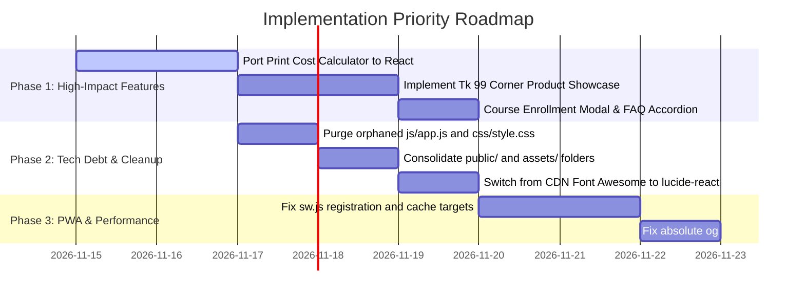

# Smart Computer & Stationary — Project Evaluation & Audit Report

**Repository:** `smart-computer`  
**Current Architecture:** React 18 + Vite 6 + Tailwind CSS (Single Page Monograph Application)  
**Proprietor:** Shafayat Hossain  
**Deployment Targets:** Wasmer Edge (`smart-computer.wasmer.app`) & GitHub Pages (`jqsafi.github.io/smart-computer/`)  
**Audit Date:** November 2026  

---

## 1. Executive Summary

This project is a single-page web portal for **Smart Computer and Stationary**, located beside the School & College Canteen Gate. It bridges local academic and citizen needs (government job submissions, photo studio, photocopying, computer training, and stationery) with digital ordering through WhatsApp.

The web app has recently undergone an aesthetic redesign into an **"Alphabet (abc.xyz) inspired luxury monograph"** design system featuring midnight navy backgrounds, cobalt/sky blue chrome gradients, and editorial typography. However, this redesign created a significant divide between the new React frontend and the previous vanilla JavaScript implementation (`js/app.js`), resulting in **orphaned files, broken PWA configurations, and several high-converting interactive features being left behind**.

---

## 2. The Good Things (Strengths & Highlights)

### 🎨 1. High Visual Polish & Distinctive Brand Identity
- **Monograph Editorial Aesthetic:** The styling draws inspiration from Alphabet's `abc.xyz` with deep midnight navy (`#060D17`), cobalt blue (`#1D4ED8`), and sky blue (`#38B6FF`).
- **Typography Pairing:** Graceful multi-font synergy between `Cormorant Garamond` (editorial serif), `Cinzel` (classical roman), and `Plus Jakarta Sans` (modern clean body).
- **Visual Depth:** Multi-layered radial navy glows, Sky-Blue microdot grid overlays, subtle colonnade architectural arches, and metallic text gradients (`brand-foil`).

### 📱 2. Mobile-Optimized & Touch-First Interactions
- **Touch Gesture Integration:** `HeroSlider.jsx` implements native touch swipe detection (`touchstart`, `touchend`) with a 50px threshold.
- **Hardware & Keyboard Controls:** Supports Left/Right arrow keys for slide navigation and auto-pauses on hover.
- **Smooth Layout Clamping:** Headings utilize CSS `clamp(1.5rem, 4.6vw, 4.75rem)` to prevent text clipping across mobile screens.

### 💬 3. Tailored WhatsApp Conversion Funnel
- Every component incorporates contextual WhatsApp URL generators:
  - Slide inquiries: Pre-filled with specific department topics.
  - Notices: `NoticeBoard.jsx` creates one-click application requests with the job/circular title.
  - File upload: `FileUploadBox.jsx` prompts students to transmit thesis/NID files without queueing.
  - Floating sticky action buttons with glowing pulses.

### 🚀 4. Dual Deployment & Automated CI/CD
- **Wasmer Edge:** Configured via `wasmer.toml` and `app.yaml` using `wasmer/static-web-server` for low-latency edge serving.
- **GitHub Pages:** Automated deployment pipeline in `.github/workflows/deploy.yml` triggered on pushes to `main`.
- **Relative Base Asset Path:** `base: './'` in `vite.config.js` ensures assets resolve properly on subpaths.

---

## 3. The Bad Things (Issues, Tech Debt & Regressions)

### ⚠️ 1. Orphaned Legacy Code & Asset Duplication
- **Dead 768-Line File:** `js/app.js` and `css/style.css` reside in the root directory but are never loaded by `index.html`.
- **Redundant Asset Storage:**
  - `assets/` and `public/assets/` contain identical image files (`logo.png`, `smart_blocks.png`, `blocks_ref.png`, `logo.webp`).
  - `favicon.svg` and `manifest.json` exist in both root and `public/`.
- **Large Binary in Git:** `assets/logo.psd` (3.4 MB Photoshop document) is committed directly into the git repository, inflating clone times unnecessarily.

### 📉 2. Lost High-Value Features (Feature Regression)
The legacy `js/app.js` contained interactive utilities that provided tangible value to students and customers, but were omitted during the React migration:

| Feature in `js/app.js` | Current React Status | Impact |
| :--- | :--- | :--- |
| **Interactive Print & Copy Cost Estimator** | **Missing** | Students could customize page count, single/double sided, B&W vs color, and binding (spiral/staple/lamination) to see dynamic pricing and generate a precalculated WhatsApp order. |
| **Tk 99 Student Value Corner Grid** | **Missing** (reduced to 4 generic bullet points) | Catalog of 10 actual items (OTG adapters, Casio calculators, highlighters, paper reams) with real prices, discounts, and order buttons. |
| **Notice Board Search & Rich Metadata** | **Simplified** | Lost the live search box, post count breakdown, government application fees, and days-left countdown badge. |
| **Course Enrollment Modal** | **Missing** | Interactive form allowing students to choose computer course, shift (morning/afternoon), and institute. |
| **FAQ Accordion** | **Missing** | Clear answers for common queries (NID retrieval, photo sizes, computer course schedules). |

### 🛠️ 3. Broken Service Worker & PWA Integration
- `sw.js` is located in the root instead of `public/`, meaning Vite does not include it in `dist/`.
- `sw.js` attempts to cache `./css/style.css` and `./js/app.js`, neither of which exists in production builds.
- Neither `index.html` nor `src/main.jsx` registers the service worker (`navigator.serviceWorker.register`), leaving PWA offline support completely inoperative.

### 📦 4. Dependency & Icon Discrepancy
- `package.json` installs `"lucide-react": "^1.16.0"`, but no component imports or uses it.
- Instead, the components rely on Font Awesome 6 CDN (`cdnjs.cloudflare.com`) injected via `<link>` in `index.html`. If the CDN is blocked, slow, or offline, icons fail to render.

### 🌐 5. Open Graph & Social Sharing Flaws
- `index.html` sets `<meta property="og:image" content="assets/logo.png" />`. Social platforms (WhatsApp, Facebook, LinkedIn) require **absolute URLs** (e.g. `https://smart-computer.wasmer.app/assets/logo.png`) to display link previews correctly.
- Missing Twitter/X card metadata (`twitter:card`, `twitter:image`).

---

## 4. Prioritized Improvement Roadmap (TODO)

